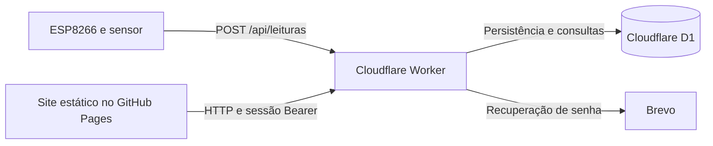

# Arquitetura e mapa do código

[Voltar ao README](../README.md) · [Rodar localmente](DESENVOLVIMENTO.md)

## Caminho de uma leitura

1. O ESP envia litros medidos ou fluxo e intervalo. Chaves de cinco dígitos exigem também o identificador do ESP.
2. `postReading`, em `api/src/index.js`, autentica o dispositivo, valida os dados, converte fluxo em litros quando necessário e grava a leitura.
3. O navegador faz login e recebe uma sessão. `docs/account.js` centraliza chamadas HTTP e inclui o token Bearer.
4. `requireDevice` identifica a conta e restringe a consulta ao dispositivo dela. `dashboardRange` retorna totais e séries.
5. `docs/dashboard.js` apresenta os dados e permite exportar o histórico em CSV.

## Onde procurar e onde alterar

| Área | Arquivos e pontos de entrada |
|---|---|
| Requisições, sessão, perfil e tema | `docs/account.js`; estilos em `docs/account.css` e `docs/themes.css` |
| Cadastro, login e recuperação | `docs/auth.html`, `docs/auth.js`; `register`, `login`, `forgotPassword`, `resetPassword` na API |
| Painel, filtros e Meu ESP | `docs/dashboard.html`, `docs/dashboard.js`, `docs/dashboard.css` |
| Funções compartilhadas das páginas | `docs/app.js`; inicialização de tema em `docs/theme-init.js` |
| Conteúdo público | `docs/index.html`, `docs/sobre.html`, `docs/dicas.html`, `docs/artigos.html` |
| Rotas HTTP | Despacho por método e caminho no final de `api/src/index.js` |
| Execução local Flask | `app.py`, `local_app/`, `templates/local/page.html`, `requirements.txt` e `tests/test_flask.py` |
| Banco | `api/schema.sql`, `api/migrations/` e binding `DB` em `api/wrangler.toml` |
| Exemplos de hardware | Arquivos `codigo_arduino.txt`, `código arduino.txt` e `codigo_wifi.txt`; confira a compatibilidade com a [API atual](../api/README.md) antes de gravar no ESP |

## Regras que uma melhoria deve preservar

- **Isolamento:** consultas de consumo usam o dispositivo pertencente à conta autenticada. Um `device_id` informado pelo cliente não concede acesso.
- **Sessões:** `createSession` assina a sessão com HMAC; `currentUser` verifica assinatura, expiração e `auth_version`. Trocar ou recuperar a senha revoga sessões antigas.
- **Acesso ao ESP:** `validDeviceAccess` verifica uma autorização de três minutos com escopo específico, conta, dispositivo e versão da senha. Ela não substitui a sessão de login.
- **Chaves:** códigos novos têm cinco dígitos e são strings para preservar zeros iniciais. A verificação usa HMAC ligado ao identificador; o armazenamento recuperável usa AES-GCM com chave derivada de `AUTH_SECRET`. Não troque esse segredo como parte de um deploy comum.
- **Tentativas:** os contadores no D1 são atualizados atomicamente antes da validação. Não separe a leitura e a atualização em operações concorrentes sem proteção.
- **Datas:** medições são normalizadas para `America/Sao_Paulo`. Filtros incluem o último dia usando um limite exclusivo no início do dia seguinte.
- **Ausência de dados:** um dia sem leitura não equivale a zero litros. A média usa dias com medições; agregações visuais não devem inventar leituras.

## Banco e evolução

`users` guarda contas; `devices` vincula cada ESP ao proprietário; `readings` contém as medições. `user_settings` reúne preferências e versão de autenticação. As demais tabelas guardam recuperação de senha, chaves cifradas e limites de tentativas.

`schema.sql` representa o estado de um banco novo. Ao mudar a estrutura, prepare uma migration para bancos existentes e atualize o schema consolidado. Explique no PR a ordem de aplicação e publicação. Antes de executar migrations em produção, leia cada SQL e confira o estado do banco: arquivos antigos não devem ser reaplicados indiscriminadamente.

## Execução local com Python

`app.py` inicia o Flask; `local_app/__init__.py` configura o SQLite, as páginas e os arquivos públicos; `local_app/api.py` implementa as mesmas rotas consumidas pela interface. `local_app/security.py` concentra sessões assinadas, autorização temporária do ESP, cifragem das chaves e reserva atômica de tentativas.

O Flask usa `templates/local/page.html` para incluir as páginas atuais de `docs/`, com um prefixo de loader que evita conflito com os templates antigos. O template injeta uma meta de configuração: presente, ela faz `docs/account.js` consultar a API na mesma origem; ausente, o JavaScript mantém a API Cloudflare publicada. Nenhuma escolha de backend depende apenas de o endereço ser localhost.

O banco e o segredo ficam em `instance/`, sem compartilhar dados ou credenciais com produção. Não há importação automática do MySQL antigo ou do D1. O schema inicial é compartilhado, mas os formatos de hash de senha são próprios de cada backend; não copie usuários entre bancos sem preparar uma migração explícita.

Os templates antigos fora de `templates/local/` e os arquivos de `static/` permanecem como referência histórica. Não são usados para montar a interface atual. Os arquivos CSS, JavaScript e imagens vêm de `docs/` nos dois modos.

Para mudar o contrato de uma rota usada pelo painel, atualize as duas implementações e execute as suítes compartilhadas contra ambas. Mudanças só no Python não alteram o backend publicado.
